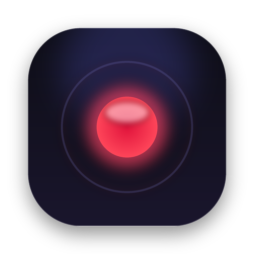

# RecoreAle

<p align="center">
  
</p>

<p align="center">
  
  
  
</p>

<h3 align="center">Create polished walkthroughs, product demos, and tutorial videos in minutes</h3>

**RecoreAle** is an open-source desktop screen recorder and professional motion video editor engineered for creators, software developers, educators, and product teams. It delivers high-production values—dynamic auto-zooming, smooth cursor tracks, customized backgrounds, webcam bubbles, and studio frame styling—directly on your machine without requiring complex timeline video suites.

---

## Key Features

### 🎬 Screen Recording & Capture Backends
- **macOS Native ScreenCaptureKit (SCK)**: Hardware-accelerated recording on macOS 14.0+ with dedicated high-performance Swift helpers (`ScreenCaptureKitRecorder`, `ScreenCaptureKitWindowList`, `SystemCursorAssets`, `NativeCursorMonitor`).
- **Windows Graphics Capture (WGC)**: Native GPU-accelerated capture with WASAPI low-latency loopback audio.
- **Linux Recording**: Display and window capture with native audio routing.
- **Multi-display & Window Isolation**: Capture fullscreen, custom regions, or pinpoint individual app windows.
- **Microphone & System Audio Muxing**: Record voice narration alongside crisp system sound.

### 🔍 Motion & Auto-Zoom
- **Intelligent Cursor-Driven Auto-Zoom**: Automatically zooms and pans into user actions, clicks, and keystrokes.
- **Smooth Cursor Trajectories**: Records cursor coordinates and renders polished, customizable cursor trails and click ripples.
- **Custom Zoom Regions**: Easily create, trim, and adjust manual zoom keys on the visual timeline.

### 🎨 Studio Canvas & Framing
- **Beautiful Backgrounds**: Gradients, mesh wallpapers, colors, blur underlays, and custom image backdrops.
- **Window Framing & Shadows**: Add macOS-style titlebars, window controls, rounded corners, drop shadows, and adjustable padding.
- **Interactive Webcam Overlay**: Positionable webcam bubble with roundness control, mirroring, shadows, and zoom-reactive framing.

### ✂️ Precision Timeline Editor
- **Non-destructive Project Workflow**: Save and resume anytime with native `.recoreale` project packages (with backward compatibility for `.recordly` files).
- **Trimming & Speed Regions**: Cut out mistakes, speed up repetitive tasks, or create dramatic slow-motion moments.
- **Annotations & Captions**: Text overlays, figures, callouts, arrows, and automated Whisper captions (`v1.8.4`).
- **Direct Export**: Ultra-fast MP4, WebM, and GIF rendering with optional NVIDIA CUDA/NVENC hardware acceleration.

---

## Project Structure

```
RecoreAle/
├── electron/                 # Electron main and preload processes
│   ├── main.ts               # App entrypoint, lifecycle, IPC bootstrapping
│   ├── windows.ts            # Window creation and management
│   ├── appPaths.ts           # Application data paths (RecoreAle-dev / RecoreAle)
│   ├── native/               # Compiled native helpers (macOS SCK & Windows WGC)
│   │   ├── bin/darwin-arm64/ # Apple Silicon Swift helper binaries
│   │   └── bin/darwin-x64/   # Intel Mac Swift helper binaries
│   └── ipc/                  # Modular IPC handlers (recording, project, export)
├── src/                      # React 19 Frontend & Video Editor Canvas
│   ├── components/           # UI components, timeline, dashboard, canvas
│   ├── contexts/             # ThemeContext (recoreale.theme), Session, Recording
│   ├── i18n/                 # Localization (EN, TR, ES, FR, etc.)
│   └── lib/                  # Utilities, math, geometry, color palettes
├── public/                   # Static web assets & RecoreAle icons
├── scripts/                  # Build scripts & native helper compilers
└── package.json              # Project definition & scripts
```

---

## Getting Started

### Prerequisites
- **Node.js**: v20 or higher (Node v22+ recommended)
- **NPM**: v10 or higher
- **macOS Requirements**: macOS 14.0+ and Xcode Command Line Tools (`swiftc` for native helpers)
- **Windows Requirements**: Windows 10 Build 19041+ with Visual Studio C++ build tools

### Installation

```bash
# Clone the repository
git clone https://github.com/themanoftalent/RecoreAle.git
cd RecoreAle

# Install dependencies (automatically prepares native helpers & whisper)
npm install
```

### Development

```bash
# Start Vite renderer and Electron concurrently in development mode
npm run dev
```

### Testing & Verification

```bash
# Run TypeScript typechecks
npm run typecheck

# Run test suite
npm run test
```

### Packaging & Release

```bash
# Package for macOS (DMG and Zip)
npm run package:mac

# Package for Windows (NSIS and portable)
npm run package:win

# Package for Linux (AppImage and deb)
npm run package:linux
```

---

## File Formats & Compatibility

RecoreAle introduces `.recoreale` as the default project file format:
- **`.recoreale`**: High-performance JSON manifest and bundled media assets preserving all cuts, zooms, annotations, and camera tracks.
- **Backward Compatibility**: Fully opens and edits legacy `.recordly` and `.openscreen` project files seamlessly.

---

## Credits & Acknowledgements

RecoreAle is maintained and enhanced by **SoftAI Yazılım (Mehmet Akif Çifçi)**.

RecoreAle builds upon the pioneering open-source work of:
- [Recordly](https://github.com/webadderallorg/Recordly) by [@webadderall](https://x.com/webadderall)
- [OpenScreen](https://github.com/siddharthvaddem/openscreen) by Siddharth Vaddem

Licensed under the **GNU Affero General Public License v3.0 (AGPL-3.0)**.
